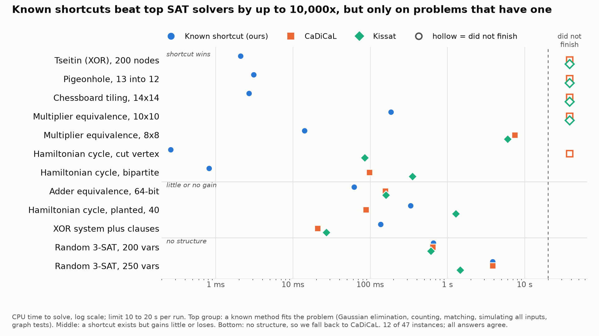

# The shortcut challenge: an open invitation to show a SAT solver is new

**A small, friendly, reproducible test for any new SAT solver that reports very large speedups.**

It was prompted by Luke Hutchison's [Frobenius](https://x.com/LH/status/2124247270824812710), reported as "an average of thousands of times faster than state of the art solvers across all problems". We think that is an exciting claim and we would like it to be true. This repository does not say it is false. It sets out, as concretely as we can, what a result like that needs to show, and offers a neutral place to show it. Luke, if you read this: consider it an invitation, not a rebuttal.



## What we found

We took methods that have been known for years, some for decades, and ran them against [CaDiCaL](https://github.com/arminbiere/cadical) and [Kissat](https://github.com/arminbiere/kissat) on 47 problems in nine families.

| Family | Shortcut used | Result |
|---|---|---|
| Tseitin formulas (hidden XOR equations) | Gaussian elimination | **2 ms; both solvers gave up after 20 s** |
| Pigeonhole | a matching count | **3 ms; both gave up after 20 s** |
| Mutilated chessboard | perfect matching | **3 ms; both gave up after 10 s** |
| Multiplier equivalence, 10x10 | simulate every input | **184 ms; both gave up after 10 s** |
| Hamiltonian cycle, unsolvable cases | degree, cut-vertex and bipartite tests | 50 to 300 times faster |
| Adder equivalence, 64-bit | SAT sweeping | about 2 times faster |
| Hamiltonian cycle, planted, 40 nodes | depth-first search | **slower** than CaDiCaL |
| XOR system plus random clauses | Gauss, then enumerate | no gain |
| Random 3-SAT | none exists | no gain (falls back to CaDiCaL) |

Every answer agrees with the standard solvers wherever they finished. Full numbers are in [results/RESULTS.md](results/RESULTS.md).

**The point.** Where a problem has a known shortcut, using it beats the best general solvers by factors of thousands. Where it has none, there is nothing to gain. So a benchmark table in which one solver wins every row by thousands is exactly what you get when every test problem has a shortcut. Such a table cannot tell a new technique from an old one.

That is not a criticism of building a solver this way. Recognising structure and dispatching to the right method is real engineering, and several production solvers do some of it. It is a different claim from being faster on all problems.

## The SHA-256 nonce benchmark

On 27 November 2026 Frobenius was reported as 38,000 times faster than CaDiCaL, 61,400 times faster than Kissat and up to 2.17 million times faster than CryptoMiniSat "in the exponential limit" on SHA-256 nonce preimages. That benchmark is [public](https://github.com/lukehutch/SAT-benchmarks/tree/main/sha256-64r-nonce-scaling), so we tested it directly.

Each instance is full 64-round SHA-256 with the digest given and the low k bits of one message word unknown, for k = 1 to 32. At k = 32 there are about 4.3 billion candidates. Frobenius's own write-up says it solves them by computing the hash for every candidate, at about 30 million per second. We wrote that loop in plain C ([`shortcuts/nonce_bruteforce.c`](shortcuts/nonce_bruteforce.c)):

| k = 32, one core | Time |
|---|---|
| Plain loop using the CPU's SHA-256 instructions (Apple M3) | **47 s** |
| Frobenius, as reported (Ryzen 9 5950X) | 87 s |
| Plain loop, portable C (Apple M3) | 472 s |

So the headline ratios measure how much faster brute force hashes than clause-learning solvers, which are known to be poor at hash preimages. They are also extrapolated: no CDCL solver was run past k ≈ 17. All the solvers, Frobenius included, double their time with each extra bit. Our Kissat times on the same files at k = 10 and 12 matched the published table. Details are in [results/SHA256-NONCE.md](results/SHA256-NONCE.md).

**This is a textbook case of the point above.** The problem has a known shortcut, which here is simply evaluating the function on every candidate, and the solver uses it. So we added Tier 4: SHA-256 problems with too many unknown bits to enumerate, where Kissat still solves most of them.

## What a new solver would need to show

In one sentence: **a large speedup, with checked certificates, on problems that nobody chose to suit the method and that have no known shortcut.**

[CHALLENGE.md](CHALLENGE.md) turns that into four tiers:

1. **Tier 1, our 47 instances.** Match or beat the shortcuts. This shows your solver finds structure. It does not show it is new.
2. **Tier 2, a neutral public set.** The SAT Competition main-track benchmarks, which nobody chose to suit a method.
3. **Tier 3, problems with no known shortcut.** Uniform random 3-SAT at the hard ratio, 25 instances with fixed seeds, generated by a script in this repository.
4. **Tier 4, too big to enumerate.** 24 reduced-round SHA-256 preimages with at least 64 unknown bits, so trying candidates one by one would take thousands of years. Kissat solves 18 of them anyway, by reasoning instead of enumerating.

A solver that is thousands of times faster "across all problems" will show it on tiers 2 to 4. Every answer must come with a certificate: a satisfying assignment (for Tier 4, one that hashes to the given digest), or a proof of unsatisfiability that a standard checker accepts.

Results are welcome as an issue or a pull request, from anyone, for any solver. We will rerun what we can and publish the outcome whichever way it goes, including if it shows we were wrong to be cautious.

## The other claims in the thread

The posts make several claims. This repository tests two of them. For fairness, here is where each stands as far as we can tell.

| Claim | Can it be checked? | Where it stands |
|---|---|---|
| Thousands of times faster "across all problems" | Yes, on neutral benchmarks | The one this challenge is about. Not yet verifiable: the code is not public. |
| The gap grows as problems get larger | Yes | We see the same with known shortcuts on structured families: the shortcut is polynomial and the general solver is not. So this is expected whether or not the method is new. |
| It solves "a large subset of the NP-complete problem space in polynomial time" | Partly | True of every shortcut used here, each for its own family. The open question is how large the subset is. |
| Speedups from 3.7x on Hamiltonian-cycle problems from six published families | Yes | The most checkable claim, and a believable size. Families chosen by other people are a fairer test than a home-made table. Our own graph method won on unsolvable cases and lost on one solvable case, so we have little to add here. We read only the opening of that post. |
| 38,000x to 2,170,000x faster on SHA-256 nonce preimages "in the exponential limit" | Yes, instances are public | Frobenius solves the benchmark by brute force (about 30M SHA-256 evaluations per second). A plain brute-force loop does the 32-bit case in 47 s against its reported 87 s. The ratios compare hashing speed with CDCL, extrapolated past k ≈ 17. See [the section above](#the-sha-256-nonce-benchmark). |
| Built in under five minutes and about twenty prompts | No | Only the author can know. It is consistent with combining existing methods. |

We have left out the post's remarks comparing AI models. They are one person's experience on one task and nothing here can test them.

## Taking up the offer

The thread also says: "If anyone has a hard SAT problem they want to test this with, please send me the link and I'll hopefully be able to send you back the solution (and proof, for UNSAT)."

That is a generous offer, and it is exactly what Tiers 3 and 4 ask for. So here is our request, made in that spirit:

- **Tier 3:** the 25 instances written by `shortcuts/tier3.py`, with checksums in `results/MANIFEST-tier3.sha256`. A satisfying assignment for each satisfiable one, and a DRAT or LRAT proof for each unsatisfiable one, with the time taken.
- **Tier 4:** the 24 instances in `instances/tier4/`, with checksums in `results/MANIFEST-tier4.sha256`. A satisfying assignment for each, with the time taken.

We will check every certificate and publish the result here. Proofs are checked with [tenet-sat](https://github.com/keithadler/tenet-sat), a parallel LRAT checker: the two Tier 3 proofs CaDiCaL wrote (about 40 s each to produce) check in under a second each, and all 26 proofs for our unsatisfiable instances verify ([results/PROOFS-TENET-SAT.md](results/PROOFS-TENET-SAT.md)). drat-trim, lrat-trim and cake_lpr are accepted too.

**Tier 3 baseline.** Kissat 4.0.4 with a 300-second limit solved 17 of the 25: 15 satisfiable (0.07 to 49 seconds) and 2 unsatisfiable (43 and 56 seconds, both at 300 variables). It did not finish the other 8, which are probably unsatisfiable. Details are in [results/TIER3-BASELINE.md](results/TIER3-BASELINE.md). So the test is concrete: checked proofs for those 8, or for the two solved unsatisfiable ones in well under a second, would be strong evidence.

**The satisfiable ones are not the test.** Satisfiable random 3-SAT is a known exception: plain local search has long beaten clause-learning solvers on it. A 60-line textbook probSAT ([`shortcuts/probsat.c`](shortcuts/probsat.c)) solves all 15 satisfiable Tier 3 instances in milliseconds; see [results/TIER3-LOCALSEARCH.md](results/TIER3-LOCALSEARCH.md). So a fast time on those matches a known method. The unsatisfiable ones are where a new method would show.

**Tier 4 baseline.** Each of the 24 instances fixes the full digest of a reduced-round SHA-256 and leaves 64 or all 512 message bits unknown, so enumeration would take thousands of years. Kissat solves the 64-bit ones in about a second each and the 17- and 18-round full-message ones in 0.4 to 201 seconds, but none at 19 or 20 rounds in 300 s ([results/TIER4-BASELINE.md](results/TIER4-BASELINE.md)). Every answer can be checked by hashing it: `python shortcuts/tier4_check.py INSTANCE OUTPUT`. Solving the 19- and 20-round ones would be real evidence.

## Reproduce our numbers

You need Python 3, a C compiler for `python-sat`, and `kissat` on your path.

```bash
python3 -m venv .venv && .venv/bin/pip install -r requirements.txt
```

```bash
cd shortcuts && ../.venv/bin/python bench.py 20
```

```bash
cd shortcuts && ../.venv/bin/python more.py 10
```

```bash
cd shortcuts && ../.venv/bin/python tier3.py
```

```bash
cd shortcuts && python3 tier4.py && python3 tier4_baseline.py 300 4
```

The first two write each instance to `shortcuts/cnf/` in DIMACS format as they run, and print one line per instance. The argument is the time limit in seconds. The third writes the Tier 3 instances. The fourth writes the Tier 4 instances and runs Kissat on them, checking every model by hashing it; it needs only Python 3 and `kissat`.

**You do not need to run anything to get the instances.** All 96 are in [`instances/`](instances): the 47 Tier 1 files in `instances/tier1/`, the 25 Tier 3 files in `instances/tier3/` and the 24 Tier 4 files (xz-compressed) in `instances/tier4/`, byte-identical to what the scripts write. Checksums are in `results/`, so you can confirm you are solving the same problems.

## What is in here

| Path | What it is |
|---|---|
| `shortcuts/gen.py` | generators: Tseitin, pigeonhole, random 3-SAT |
| `shortcuts/structsat.py` | reads plain CNF, recovers XOR constraints and pigeonhole shape, else calls CaDiCaL |
| `shortcuts/more.py` | circuits (adders, multipliers), chessboard, Hamiltonian cycle, mixed XOR, with their shortcuts and the harness |
| `shortcuts/bench.py`, `run_cadical.py` | the first harness |
| `shortcuts/tier3.py` | the Tier 3 instances |
| `shortcuts/probsat.c` | a minimal local search, as a reference point for the satisfiable Tier 3 instances |
| `shortcuts/sha256cnf.py`, `tier4.py` | reduced-round SHA-256 as CNF with a planted preimage; the Tier 4 instances |
| `shortcuts/tier4_check.py`, `tier4_baseline.py` | checks a Tier 4 answer by hashing it; the Kissat baseline |
| `shortcuts/nonce_bruteforce.c` | the plain enumeration loop for the SHA-256 nonce benchmark |
| `shortcuts/proofs_tenet_sat.sh` | writes LRAT proofs with CaDiCaL for the unsatisfiable instances and checks them with tenet-sat |
| `instances/` | all 96 instance files in DIMACS format |
| `shortcuts/chart.py` | draws the chart |
| `results/` | our numbers, the chart, and checksums |

## Limits of this work

- **It says nothing about how Frobenius works.** Its code is not public. We reproduced the *shape* of its benchmark table on families we could build. We could not build the families only its author defines. Its SHA-256 nonce benchmark is the exception: those instances are public, and we tested it directly.
- **We did not reproduce everything.** On adders our shortcut gained about 2x, and on planted Hamiltonian cycles it lost. On multiplier problems with a fixed output, the standard solvers already take milliseconds on our instances.
- **Some shortcuts were given the original object** (the circuit or the graph), not only the encoded formula. The table in `results/RESULTS.md` says which.
- **All 47 Tier 1 instances were generated by us**, and those timings were taken on a heavily loaded laptop. The large ratios are robust to that; the small ones are not.
- **The SHA-256 nonce comparison crosses machines.** Our 47 s is on an Apple M3 and Frobenius's 87 s on a Ryzen 9 5950X, so the exact ratio means little. The point is only that a plain loop lands in the same range.
- **Tier 4 is not a claim about SHA-256 security.** Reduced to 13 to 20 rounds, the hash is far weaker than the full 64 rounds. The instances are chosen so that a solver must reason rather than enumerate, not because they are cryptographically meaningful.
- **"Gave up" is a time limit, not a proof of hardness.** Ratios against a timeout are lower bounds.
- Nothing here is a new technique. Every method used is in the literature.

## Credits

Keith Adler, working with Claude (Anthropic). tenet-sat is by Keith Adler. CaDiCaL and Kissat are by Armin Biere and collaborators; `python-sat` is by Alexey Ignatiev and collaborators.

License: Apache-2.0.
